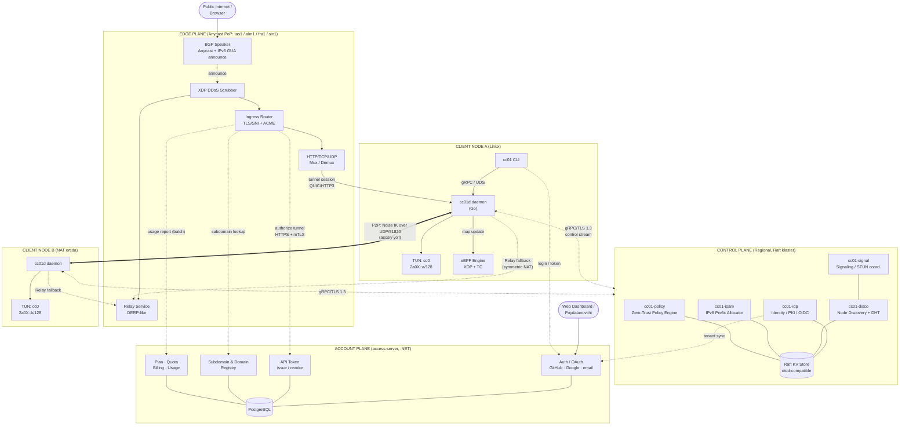
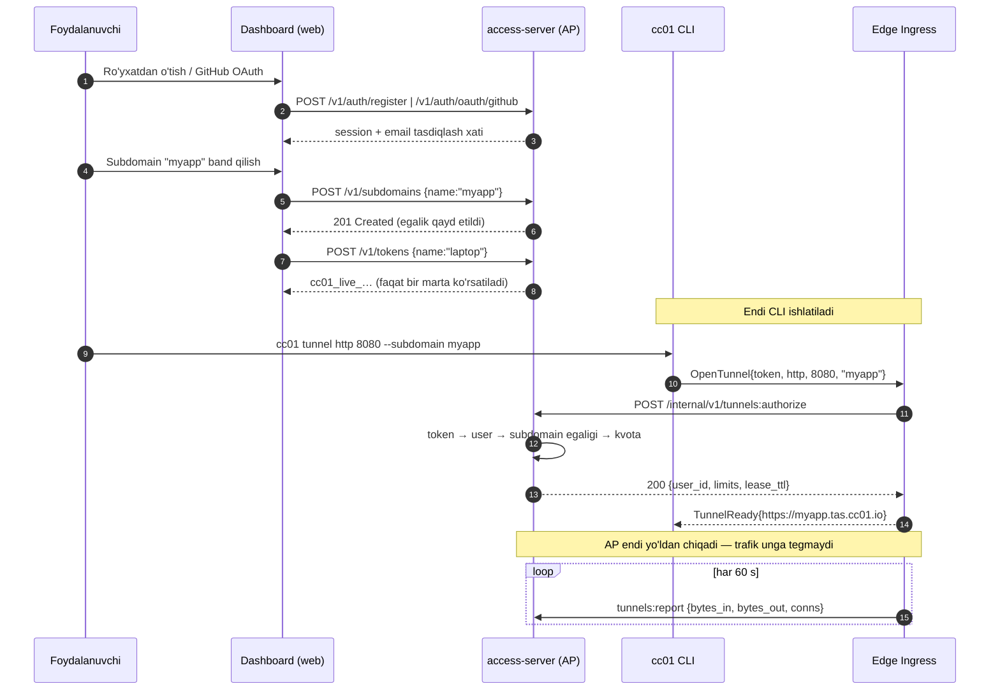
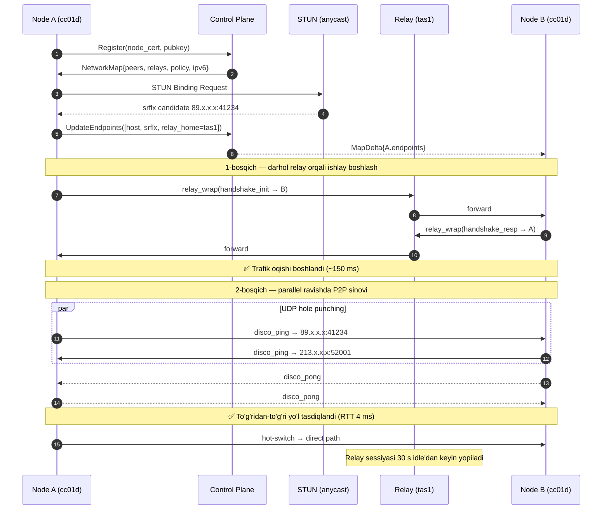
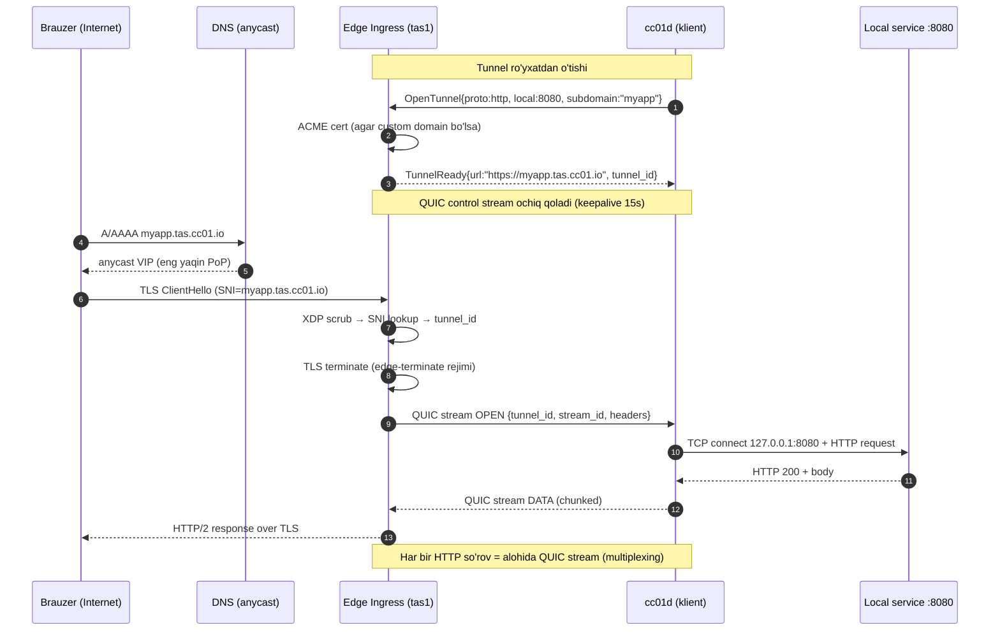
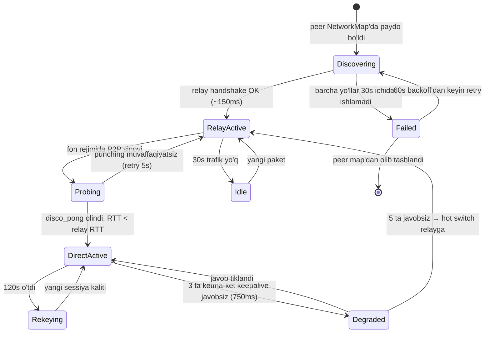

# cc01 — Tizim Arxitekturasi (ARCHITECTURE.md)

| Maydon | Qiymat |
| --- | --- |
| Hujjat versiyasi | `1.0.0` |
| Status | `Design Review` → `Accepted` (RFC bosqichida) |
| Kod nomi | `cc01` (Cloud Connect 01) |
| Egasi | Platform & Network Engineering |
| Auditoriya | Network/Kernel muhandislari, Backend developerlar, SRE, Security jamoasi |
| Bog'liq hujjatlar | `DEV_SPEC.md`, `adr/ADR-009.md`, `SECURITY_MODEL.md`, `OPS_RUNBOOK.md` |

---

## 0. Terminologiya (Glossary)

| Termin | Ta'rifi |
| --- | --- |
| **CP (Control Plane)** | Holat, identifikatsiya, IPAM va signaling'ni boshqaruvchi markaziy mantiq — **mashinaga qaragan** (node, daemon, edge). Foydalanuvchi paketlarini **ko'rmaydi**. |
| **AP (Account Plane)** | `access-server` (.NET) — **odamga qaragan** qatlam: hisob, autentifikatsiya, API token, subdomain egaligi, tarif va billing. Trafik yo'lida turmaydi. Batafsil §3.4. |
| **DP (Data Plane)** | Klient daemon + eBPF dvigatel + edge proxy — real paketlarni uzatuvchi qatlam. |
| **PoP (Point of Presence)** | Geografik nuqtada joylashgan edge klaster (masalan `tas1` — Toshkent/TasIX). |
| **IPAM** | IP Address Management — IPv6 prefikslarni ijaraga berish va qaytarib olish tizimi. |
| **XDP** | eXpress Data Path — NIC drayveri darajasida ishlovchi eng tezkor eBPF hook. |
| **TC (Traffic Control)** | `clsact` qmdisc'dagi eBPF hook — ingress/egress uchun (XDP'dan keyingi bosqich). |
| **Noise IK** | WireGuard asosidagi kriptografik handshake pattern (statik kalit initiator tomonidan ma'lum). |
| **Relay Node** | P2P imkonsiz bo'lganda shifrlangan trafikni "ko'r" holda uzatuvchi tugun (DERP-ga o'xshash). |
| **GUA / ULA** | Global Unicast Address (`2000::/3`) / Unique Local Address (`fd00::/8`). |
| **TasIX** | O'zbekiston Trafik Almashinuv Nuqtasi — mahalliy peering fabric. |
| **Tenant** | Bitta tashkilot/foydalanuvchi hisobi (izolyatsiya chegarasi). |
| **Node** | Tenantga tegishli bitta qurilma (laptop, server, konteyner, telefon). |
| **Fail-static** | CP ishlamay qolganda DP oxirgi ma'lum konfiguratsiya bilan ishlashda davom etishi. |

> **Atama haqida izoh:** tarmoq sohasida "user plane" odatda *data plane* ma'nosini beradi. Chalkashmaslik uchun odamga qaragan qatlam bu hujjatda **Account Plane (AP)** deb ataladi, "user plane" emas.

---

## 1. System Overview

### 1.1 Maqsad

`cc01` — bu uchta odatda alohida bo'lgan mahsulotni bitta data plane'da birlashtiruvchi platforma:

1. **Overlay Mesh VPN** (Tailscale/ZeroTier sinfi) — qurilmalar orasida to'g'ridan-to'g'ri shifrlangan P2P tarmoq.
2. **Public IPv6 Allocation** — har bir tenant/qurilmaga marshrutlanuvchi **haqiqiy public IPv6** manzili (NAT ortidagi qurilma ham internetdan to'g'ridan-to'g'ri erishiladigan bo'ladi).
3. **Ingress Tunneling** (ngrok/Cloudflare Tunnel sinfi) — lokal servisni public HTTP/TCP/UDP endpoint sifatida chiqarish.

Bularning ustiga **eBPF/XDP asosidagi yadro darajasidagi xavfsizlik** va **TasIX-optimallashtirilgan edge transit** qo'shiladi.

### 1.2 Funksional talablar (F-series)

| ID | Talab | Ustuvorlik |
| --- | --- | --- |
| F-1 | Klient daemon TUN interfeys yaratadi, mesh'ga ulanadi, kalit almashinuvini bajaradi | P0 |
| F-2 | Har bir node uchun `/128` public IPv6, har bir tenant uchun `/64` (ixtiyoriy `/56`) | P0 |
| F-3 | NAT traversal: STUN → UDP hole punching → ICE nomzodlarni tanlash | P0 |
| F-4 | Symmetric NAT / CGNAT holatida avtomatik relay fallback (< 300 ms) | P0 |
| F-5 | `cc01 tunnel http 8080` — avtomatik TLS bilan public URL | P0 |
| F-6 | TCP/UDP port forwarding (public `host:port` → local `host:port`) | P1 |
| F-7 | eBPF firewall: L3/L4 allow/deny, rate limit, anti-DDoS | P0 |
| F-8 | Zero-Trust: har bir paket identity + policy bo'yicha tekshiriladi | P0 |
| F-9 | Anycast ingress, TasIX segmentida 1–5 ms RTT | P1 |
| F-10 | Edge compute (WASM filtrlar ingress'da) | P2 |
| F-11 | Foydalanuvchi hisobi: ro'yxatdan o'tish, email tasdiqlash, OAuth (GitHub/Google) | P0 |
| F-12 | API token bilan avtorizatsiya; subdomain **egalik qilinadi**, birinchi kelgan olmaydi | P0 |
| F-13 | Tarif kvotalari majburlanadi: tunnel soni, ulanish limiti, bandwidth | P1 |
| F-14 | Custom domen: DNS-verifikatsiya (TXT) → CNAME → avtomatik sertifikat | P1 |

### 1.3 Nofunksional talablar (NFR)

| Ko'rsatkich | Maqsad |
| --- | --- |
| P2P handshake vaqti | p50 < 250 ms, p95 < 900 ms |
| Overlay qo'shimcha kechikish (P2P, bir shahar) | < 1.5 ms |
| TasIX ichidagi RTT (klient ↔ `tas1` PoP) | 1–5 ms |
| Data plane o'tkazuvchanligi (bitta node, AES-NI bilan) | ≥ 2.5 Gbps / yadro |
| XDP filtr narxi | < 200 ns/paket, 14.8 Mpps (10G line-rate) drop |
| CP mavjudligi (SLO) | 99.95% |
| DP mavjudligi (fail-static rejimi bilan) | 99.99% |
| Klient RAM iste'moli (idle) | < 40 MB |
| Klient CPU (idle, 100 peer) | < 1% |

### 1.4 Non-goals (v1 doirasidan tashqarida)

- To'liq anonimlik (Tor tipidagi onion routing) — `cc01` **maxfiylik** beradi, anonimlik emas.
- Layer-2 bridging (broadcast domenlarni cho'zish) — faqat L3 overlay.
- IPv4 public manzil ijarasi (faqat NAT64/DNS64 orqali IPv4 mijozlarga erishish).
- Windows/macOS uchun kernel-mode eBPF (u yerda userspace filtr fallback ishlatiladi).

### 1.5 Dizayn tamoyillari

1. **Control/Data Plane qat'iy ajratilgan.** CP hech qachon foydalanuvchi trafigini ko'rmaydi va deshifrlay olmaydi.
2. **End-to-end shifrlash.** Relay va edge tugunlar — "ko'r uzatuvchi" (ingress tunnel TLS terminatsiyasidan tashqari, u aniq belgilanadi).
3. **Kernel-first.** Nima yadroda qilinishi mumkin bo'lsa — yadroda qilinadi (XDP/TC), userspace faqat boshqaruv uchun.
4. **Fail-static.** CP yo'qolsa, mavjud sessiyalar uzilmaydi; faqat yangi o'zgarishlar to'xtaydi.
5. **Local-first routing.** Trafik imkon qadar mahalliy qoladi (TasIX ichidagi trafik xalqaro kanalga chiqmaydi).
6. **Deny-by-default.** Har bir policy hisob-kitobi ochiq ruxsat bo'lmasa — DROP.
7. **Hisob va boshqaruv ajratilgan.** Odamga qaragan mantiq (hisob, to'lov, dashboard) mashinaga qaragan mantiqdan (sertifikat, IPAM, policy) alohida servisda yashaydi. AP buzilsa ham mavjud tunnellar va node kalitlariga ta'sir qilmaydi.

### 1.6 Joriy holat (2026-08-21) — spec va reallik farqi

Bu hujjat **maqsadli** arxitekturani tasvirlaydi. Repozitoriyda hozir mavjud kod ancha kichikroq qamrovda; quyidagi jadval farqni ochiq ko'rsatadi, shunda hujjat va kod o'rtasida yashirin uzilish qolmaydi.

| Spec komponenti | Repodagi holat | Farq |
| --- | --- | --- |
| Edge ingress (SNI router, QUIC, ACME) | `core-server/` — HTTP `Host:` header bo'yicha demux, TLS terminatsiya sertifikat fayldan | HTTP/1.1 gina; SNI routing, HTTP/2, WebSocket, ACME yo'q |
| Tunnel data plane (QUIC stream mux) | `core-server/tunnel/` — public↔private TCP juftlash, port raqami bilan identifikatsiya | Xom TCP; multiplexing, backpressure, flow control yo'q |
| CP ↔ node protokoli (gRPC/protobuf) | `core-server/events/` — protobuf freyming, magic+versiya preambulasi bilan | ✅ `gob` dan ko'chirildi; uzun yashovchi gRPC stream Faza 1 da |
| AP ↔ Edge avtorizatsiyasi (§3.4.3) | `core-server/access/` — gRPC klient, kesh, fail-static | ✅ ishlaydi; mTLS Faza 1 da |
| Klient daemon `cc01d` + CLI `cc01` | `cli-client/` — 173 qatorli `flag` asosidagi klient | Daemon, IPC, holat mashinasi, buyruq daraxti yo'q |
| Account Plane (`access-server`) | `access-server/` — auth, OAuth (GitHub/Google), API token, subdomain egaligi, tunnel avtorizatsiyasi | ✅ ishlaydi; billing va usage hisobi Faza 1/3 da |
| Control Plane — `cc01-ipam` | `control/ipam/` — ijara hayot sikli, sticky taqsimlash, karantin | ✅ `Register` da manzil beradi; Raft store keyingi qadam |
| Control Plane — `cc01-disco` | `control/registry/` + `control/server/` — registri, NetworkMap, delta sync, gRPC stream | ✅ `cc01d` peerlarni avtomatik oladi |
| Control Plane — idp / policy | — | Hali yo'q |
| Mesh VPN — kripto qatlami | `daemon/noise/` — Noise IK handshake, sessiya, rekey, replay oynasi | ✅ ishlaydi va sinalgan (UDP orqali ham) |
| Mesh VPN — TUN qurilmasi | `daemon/tun/` — qurilma, manzil, ajratilgan routing jadvali (51820), policy qoidalari | ✅ Linux'da ICMPv6 aylanishi bilan tasdiqlangan; macOS fallback |
| Mesh VPN — crypto router | `daemon/router/` — peer registri, `allowed_ips` LPM trie, cryptokey routing | ✅ soxtalashtirishga qarshi testlar bilan |
| Mesh VPN — UDP transport va datapath | `daemon/conn/`, `daemon/engine/` — batch I/O, handshake, keepalive, rekey | ✅ ikki konteyner o'rtasida shifrlangan `ping6` |
| Mesh VPN — STUN (`cc01-signal`) | `daemon/stun/` + `control/stunserver/` — public manzilni aniqlash | ✅ NAT ortidan ikki tomonlama ulanish |
| Mesh VPN — relay (§3.3.2) | `daemon/relay/` — ko'r uzatuvchi, ikki qatlamli shifrlash; CP `relays[]` ni tarqatadi | ✅ symmetric NAT ortidagi nodelar ulanadi |
| Mesh VPN — yo'l tanlash (§6.2) | `daemon/path/` — holat mashinasi, disco ping/pong, gisterezis | ✅ relay-first, P2P-upgrade |
| Node autentifikatsiyasi | `daemon/nodecert` + CP bog'lanishi (Raft'da) | ✅ token faqat ro'yxatga olish uchun |
| Control Plane — Raft klasteri | `control/cluster` — FSM, snapshot, lider tanlash | ✅ failover 0.9–1.0 s; klient liderni o'zi topadi |
| Control Plane — registry replikatsiyasi | `control/cluster` — node ro'yxati FSM da | ✅ failover'da peerlar saqlanadi |
| Mesh VPN — CP kanali (§5.1.1) | TLS 1.3 + SPKI pinning (server), node klient sertifikati | ✅ sertifikat almashtirish/bekor qilish ⏳ |
| Mesh VPN — hole punching (cone NAT) | `daemon/engine` — disco pong AYNAN ping kelgan yo'l bilan qaytadi | ✅ `make punch-demo` |
| Mesh VPN — hole punching (symmetric NAT) | `daemon/punch` — birthday paradoks, peerga xos soket | ✅ symmetric↔cone; symmetric↔symmetric imkonsiz |
| Mesh VPN — to'liq ICE nomzod to'plami | — | Hali yo'q (`host`/`srflx` bor, `prflx` yo'q) |
| eBPF/XDP pipeline | `daemon/xdp` — blocklist, tezlik cheklovi, avtomatik blok, hodisalar, AF_XDP redirect | ✅ SYN cookie ❌ (mustaqil ishlamaydi) |
| Zero-trust policy (eBPF) | `daemon/tcpolicy` — ingress+egress, hukm keshi, MSS clamp, DSCP | ✅ |
| Policy boshqaruvi | `cc01 firewall` + CP dan tarqatish (`control/policy`) | ✅ AP dan boshqarish ⏳ |
| Mikrosegmentatsiya (tag) | `tag:web` → node manzillari; registry versiyasiga bog'langan | ✅ lateral movement bloklanadi |
| Tunneling — SNI router + TLS | `core-server/tlsmgr` — SNI bo'yicha sertifikat, ACME | ✅ `make tunnel-demo`; wildcard fayldan (DNS-01) |
| Public IPv6 / BGP / TasIX PoP | — | Butunlay yo'q |

> **Registry ham Raft orqali ketadi.** FSM uchta narsani
> replikatsiya qiladi: IPAM ijaralari, node↔sertifikat bog'lanishi
> va node ro'yxati (`control/cluster/fsm.go`). Node ro'yxatini
> o'zgartirish faqat `registry.Apply` orqali — buyruq protobuf
> shaklida jurnalga yoziladi, vaqt va TTL esa LIDER tomonida hal
> qilinadi va buyruqqa yoziladi. Aks holda har bir replika o'z
> soatini o'qib, boshqa `ExpiresAt` yozardi.
>
> ⚠️ Muddat tekshiruvi chiqariladigan nodelarni SARALAYDI. Go'da
> map bo'ylab yurish tartibi tasodifiy, o'zgarishlar jurnali esa
> har yozuvda versiyani oshiradi — saralamasak, bir xil versiya
> har replikada boshqa nodega tegib qolardi. Buni yakuniy holatni
> solishtirib topib bo'lmaydi (u baribir bir xil); ajralish faqat
> klientning `since` versiyasi partiya o'rtasiga tushganda
> ko'rinadi. `TestFSM_RegistryIsDeterministic` aynan shuni
> tekshiradi.
>
> Relaylar esa REPLIKATSIYA QILINMAYDI: har bir CP o'zining ichki
> relay'ini e'lon qiladi va ularni jurnalga yozsak, replikalar
> bir-birining manzilini almashtirib turardi.

**Xulosa:** overlay mesh (§3.2) va eBPF xavfsizlik qatlami (§5) ishlaydi:
ikki node NAT ortidan ham to'g'ridan-to'g'ri shifrlangan kanal quradi,
Control Plane Raft klasteri sifatida ishlaydi, trafik esa XDP da
filtrlanadi va TC da deny-by-default siyosati bilan tekshiriladi.
Tunneling (§4.4) hozircha ibtidoiy: tokenli, egalik qilingan subdomain
bilan HTTP tunnel uchidan uchiga ishlaydi. Public IPv6, BGP va TasIX
PoP (§3.5) hali boshlanmagan. Amaliy ketma-ketlik `DEV_SPEC.md` §8
(Roadmap) da.

---

## 2. High-Level Architecture

### 2.1 Mermaid diagramma



**Diagrammani o'qish:** `AP` odam bilan, `CP` mashina bilan gaplashadi. Edge `AP`ga faqat **tunnel ochilayotganda** (avtorizatsiya) va **davriy** (usage hisoboti) murojaat qiladi. Paket yo'lida `AP` yo'q.

### 2.2 Qatlamli ko'rinish (ASCII)

```
                         ┌──────────────────────────────────────────┐
   L7  APPLICATION       │  cc01 CLI · Web Dashboard · REST/gRPC API │
                         └───────────────────┬──────────────────────┘
                                             │  (gRPC over UDS / mTLS)
                         ┌───────────────────┴──────────────────────┐
   L6b ACCOUNT (AP)      │  access-server: auth · token · subdomain  │
       (.NET, Postgres)  │  plan/kvota · billing · dashboard API     │
                         │  → trafik ko'rmaydi, paket yo'lida yo'q   │
                         └───────────────────┬──────────────────────┘
                                             │  (authorize · quota · usage)
                         ┌───────────────────┴──────────────────────┐
   L6a CONTROL (mashina) │  IDP · DISCO · IPAM · SIGNAL · POLICY     │
       (stateful, Raft)  │  → hech qachon user payload ko'rmaydi    │
                         └───────────────────┬──────────────────────┘
                                             │  (config push / delta sync)
                         ┌───────────────────┴──────────────────────┐
   L5  SESSION / TUNNEL  │  Ingress Router · TLS Term · Mux/Demux    │
                         │  HTTP(S) | TCP | UDP | QUIC               │
                         └───────────────────┬──────────────────────┘
                                             │
                         ┌───────────────────┴──────────────────────┐
   L4  OVERLAY TRANSPORT │  Noise IK handshake · ChaCha20-Poly1305   │
                         │  ICE (STUN/TURN) · Relay fallback         │
                         └───────────────────┬──────────────────────┘
                                             │
                         ┌───────────────────┴──────────────────────┐
   L3  PACKET / SECURITY │  TUN device (cc0) · XDP · TC · conntrack  │
       (kernel space)    │  policy LPM · rate-limit · redirect       │
                         └───────────────────┬──────────────────────┘
                                             │
                         ┌───────────────────┴──────────────────────┐
   L2/L1 PHYSICAL        │  NIC · TasIX peering · Anycast BGP · IX   │
                         └──────────────────────────────────────────┘
```

---

## 3. Component Breakdown

### 3.1 Control Plane

CP — bu Go'da yozilgan, gRPC interfeysli, Raft konsensusi bilan replikatsiyalanuvchi mikroservislar to'plami. Har bir regionda 3 yoki 5 ta replika (odd quorum).

CP **mashinaga qaragan**: uning mijozlari — node, daemon va edge. Odamga qaragan mantiq (ro'yxatdan o'tish, tarif, to'lov, subdomain egaligi) bu yerda emas, **§3.4 Account Plane**da.

#### 3.1.1 `cc01-idp` — Identity & PKI

| Vazifa | Tafsilot |
| --- | --- |
| Tenant/user autentifikatsiyasi | OIDC (Google, Microsoft, Keycloak), SSO, SAML (enterprise) |
| Qurilma ro'yxatdan o'tishi | Device Registration Flow: `device_code` → user approve → node cert |
| Sertifikat berish | Ichki CA (SPIFFE-compatible SVID), 24 soatlik qisqa muddatli node sertifikatlari |
| Kalitlar | Har bir node: Curve25519 statik kalit jufti (private kalit **hech qachon** qurilmadan chiqmaydi) |
| Revocation | CRL emas — qisqa TTL + `node_epoch` counter; revoke = epoch increment + push |

**Muhim:** CP faqat **public** kalitlarni saqlaydi. CP kompromissi trafikni deshifrlash imkonini bermaydi (faqat MITM uchun yangi kalit kiritish imkonini beradi — bunga qarshi `key pinning` + tranzitiv audit log ishlatiladi).

#### 3.1.2 `cc01-disco` — Node Discovery

Ikki qatlamli discovery:

- **Coordinated tier (default):** Tenant ichidagi barcha nodelar CP'ga uzun yashovchi gRPC stream ochadi (`WatchNetworkMap`). Har qanday o'zgarish (yangi peer, yangi endpoint, key rotation) **delta** ko'rinishida push qilinadi.
- **Decentralized tier (fallback / self-hosted):** Kademlia DHT — `node_id = SHA-256(pubkey)` bo'yicha 160-bitli keyspace. CP butunlay yo'q bo'lsa ham nodelar bir-birini bootstrap peerlar orqali topadi.

```
NetworkMap {
  tenant_id, map_version (monotonic),
  self: { node_id, ipv6, allowed_ips, tags[] },
  peers: [ { node_id, pubkey, endpoints[], relay_home, allowed_ips[], expiry } ],
  relays: [ { region, addr, pubkey, priority } ],
  policy_version, dns_config, derp_map
}
```

Delta sync: `map_version` monotonik oshadi; klient `since=N` yuboradi, CP faqat `N`dan keyingi o'zgarishlarni qaytaradi. To'liq map ≥ 500 peer'da ~200 KB, delta odatda < 2 KB.

#### 3.1.3 `cc01-ipam` — IPv6 Address Management

Ierarxik prefiks modeli:

```
2a0X:XXXX::/32              ← RIR (RIPE) tomonidan berilgan tashkilot prefiksi
   ├── 2a0X:XXXX:0000::/40  ← Region: tas (TasIX)
   │      ├── ...:0000::/48 ← PoP: tas1
   │      │     ├── ...::/56 ← Tenant (enterprise, 256 ta /64)
   │      │     │    └── ...::/64 ← Tenant network segment
   │      │     │          └── ...::/128 ← Node address
   │      │     └── ...::/64 ← Tenant (free/pro tier — bitta /64)
   ├── 2a0X:XXXX:1000::/40  ← Region: eu (fra1)
   └── 2a0X:XXXX:2000::/40  ← Region: apac (sin1)

fd01:cc01::/32              ← ULA: ichki service mesh, CP-DP boshqaruv trafigi
```

Allocation algoritmi: **buddy allocator** + Raft'ga yozilgan ijara (lease) jurnali.

| Amal | Semantika |
| --- | --- |
| `Allocate(tenant, size)` | Erkin blokni topadi, `lease{prefix, tenant, ttl=72h}` yozadi, `2PC`siz — Raft commit yetarli |
| `Renew(lease_id)` | Node har 6 soatda yangilaydi; heartbeat bilan birga |
| `Release(lease_id)` | Prefiks **quarantine** ga tushadi (24 soat) — eski marshrutlar tozalanishi uchun |
| `Reclaim()` | TTL o'tgan ijaralarni GC qiladi |

Prefiks **anchor** PoP bilan bog'lanadi: `tas1` PoP shu `/48`ni BGP orqali e'lon qiladi, shuning uchun internetdan kelgan paket avval `tas1`ga, keyin overlay orqali nodega yetadi. Node boshqa regionga ko'chsa — ikkita variant: (a) manzilni saqlash (trafik `tas1` orqali tranzit qiladi), (b) yangi manzil olish (`ipv6.mobility=renumber`).

#### 3.1.4 `cc01-signal` — Signaling / NAT Traversal Coordinator

- **STUN server** (RFC 5389) — `stun.cc01.net:3478`, har PoP'da anycast.
- **ICE candidate exchange** — CP'dagi gRPC stream orqali (SDP emas, o'zimizning kompakt protobuf).
- **Endpoint discovery:** klient o'z nomzodlarini yig'adi: `host` (LAN IP), `srflx` (STUN orqali topilgan public), `relay` (TURN/DERP), `overlay` (mavjud IPv6 GUA).
- **NAT type detection:** Full Cone / Restricted / Port-Restricted / Symmetric — birlashtirilgan STUN testlari orqali; natija cache'lanadi (10 min).
- **Birthday-paradox punching:** ✅ `daemon/punch` — `make punch-sym-demo`.

  Ikkita yarim, ikkalasi ham kerak. **Sepish:** N ta *vaqtinchalik*
  soketdan peerning ma'lum manziliga yoziladi — har biri NAT'da alohida
  yozuv ochadi. **Taxmin:** peerning IP'sida K ta tasodifiy portga
  *asosiy* soketdan yoziladi.

  ⚠️ Taxminlar aynan **asosiy** soketdan chiqishi shart. Peerning yozuvi
  u bizga qaysi manzilga yozgan bo'lsa faqat o'shandan paket qabul
  qiladi — bu esa STUN e'lon qilgan manzilimiz. Vaqtinchalik soketdan
  yuborilgan taxmin boshqa tashqi portdan chiqadi va baribir rad
  etiladi.

  Bir bosqichning ehtimoli `1-exp(-N·K/64511)`; N=256, K=512 da ~87%.
  Muvaffaqiyatsizlikdan keyingi tanaffus eksponensial o'sadi
  (5 s → 5 min), chunki relay allaqachon ishlab turibdi.

  G'olib soket peer bilan aloqani davom ettiradi: yo'l aynan o'sha NAT
  yozuvi orqali ochilgan va boshqa soketdan yuborilgan paket boshqa
  tashqi portdan chiqib rad etilardi. Shuning uchun engine peerga xos
  soketni saqlaydi.

| NAT juftligi | Natija |
| --- | --- |
| cone ↔ cone | oddiy teshik ochish — `make punch-demo` |
| symmetric ↔ cone | birthday punching — `make punch-sym-demo` |
| symmetric ↔ symmetric | **imkonsiz**, relay — `make relay-demo` |

Oxirgi qator nega imkonsiz: taxmin qiluvchining o'z tashqi porti ham
har oqimda o'zgaradi, ya'ni peerning yozuvi (u faqat bizning ma'lum
manzilimizdan qabul qiladi) uni baribir rad etadi.

**Teshik ochishning amaliy sharti** (`make punch-demo` da o'lchangan): disco
**pong AYNAN ping kelgan manzilga** qaytishi kerak, "eng yaxshi" yo'lga emas.
Aks holda relay orqali ketgan javob to'g'ridan-to'g'ri probe'ni tasdiqlamaydi
va yo'l abadiy `probing` holatida qoladi — hech qanday xato chiqmasdan.

**Cone va symmetric farqi o'lchangan.** Ikkala holat ham alohida demo
bilan qoplangan:

| NAT turi | Simulyatsiya | Natija |
| --- | --- | --- |
| Cone (endpoint-independent) | `MASQUERADE` | `direct-active`, ~400 ms — `make punch-demo` |
| Symmetric (endpoint-dependent) | `MASQUERADE --random` | relayda qoladi — `make relay-demo` |

`--random` bilan har bir oqim tasodifiy tashqi port oladi. Bitta node
uchun o'lchangan: STUN → `57174`, relay → `19530`, peer → `5275`. STUN
aytgan manzil faqat STUN oqimi uchun to'g'ri bo'lib qoladi.

⚠️ **O'lchov paytidagi tuzoq.** Kutilmagan kiruvchi paket shlyuzda
conntrack yozuvi hosil qilsa, o'sha yozuv keyin ichkaridan chiqadigan
oqimga port tanlashga aralashadi va oddiy `MASQUERADE` ham symmetric
kabi ko'rinib qoladi. Haqiqiy NAT bunday paketni mapping jadvaliga
kiritmaydi, shuning uchun ikkala demo ham uni conntrack tasdiqlashidan
oldin tashlaydi. Busiz o'lchov NAT'ning xatti-harakatini emas, shu
nojo'ya ta'sirni ko'rsatadi.

#### 3.1.5 `cc01-policy` — Zero-Trust Policy Engine

Policy'lar deklarativ ACL sifatida yoziladi (HuJSON/YAML), CP'da **kompilyatsiya** qilinadi va nodega **oldindan hisoblangan** (pre-resolved) ko'rinishda yuboriladi — klient hech qachon tag/group'ni o'zi hal qilmaydi.

```yaml
acls:
  - action: accept
    src:   ["tag:frontend"]
    dst:   ["tag:api:8443", "tag:api:443"]
    proto: tcp
  - action: accept
    src:   ["group:sre"]
    dst:   ["tag:prod:22"]
    proto: tcp
    posture: ["device.os_updated == true", "device.disk_encrypted == true"]
  - action: drop
    src:   ["*"]
    dst:   ["tag:db"]
```

Kompilyatsiya natijasi — eBPF map'ga to'g'ridan-to'g'ri yuklanadigan `(src_prefix, dst_prefix, proto, port_range, verdict)` yozuvlari.

#### 3.1.6 Holat saqlash (State Store)

| Ma'lumot | Store | Sabab |
| --- | --- | --- |
| Tenant, user, node registry | Raft KV (etcd API) | Kuchli konsistentlik shart |
| IPAM lease jurnali | Raft KV | Ikki marta berish (double-allocation) mumkin emas |
| NetworkMap snapshot | Raft KV + in-memory cache | O'qish og'ir, yozish yengil |
| Endpoint/heartbeat (o'zgaruvchan) | Redis / in-memory, TTL=90s | Raft'ga yozish qimmat, yo'qolsa qayta topiladi |
| Audit log, metrics | ClickHouse | Analitik, append-only |

**CAP tanlovi:** CP — CP-tizim (Consistency + Partition tolerance). Bo'linish holatida yozish to'xtaydi, **lekin data plane ishlashda davom etadi** (fail-static).

---

### 3.2 Data Plane — Klient Daemon (`cc01d`)

```
┌─────────────────────────────────────────────────────────────────┐
│                        cc01d (userspace, Go)                    │
│                                                                 │
│  ┌────────────┐  ┌─────────────┐  ┌──────────────┐             │
│  │ Control    │  │ Engine      │  │ eBPF Manager │             │
│  │ Client     │→ │ (state      │→ │ (map sync,   │             │
│  │ (gRPC/TLS) │  │  machine)   │  │  prog load)  │             │
│  └────────────┘  └──────┬──────┘  └──────┬───────┘             │
│                         │                │                     │
│  ┌────────────┐  ┌──────┴──────┐  ┌──────┴───────┐             │
│  │ IPC Server │  │ Conn        │  │ Ring Buffer  │             │
│  │ (UDS/gRPC) │  │ Manager     │  │ Consumer     │             │
│  └────────────┘  │ (ICE/relay) │  └──────────────┘             │
│                  └──────┬──────┘                               │
│  ┌───────────────────────┴────────────────────────┐            │
│  │  Crypto Router: Noise IK · ChaCha20-Poly1305   │            │
│  │  peer_lookup(dst_ipv6) → session → encrypt     │            │
│  └───────────────────────┬────────────────────────┘            │
│  ┌────────────┐   ┌──────┴──────┐   ┌───────────┐              │
│  │ Tunnel     │   │ TUN I/O     │   │ UDP Sock  │              │
│  │ Agent      │   │ (vectored,  │   │ (GSO/GRO, │              │
│  │ (ngrok f.) │   │  batch=128) │   │  sendmmsg)│              │
│  └────────────┘   └──────┬──────┘   └─────┬─────┘              │
└──────────────────────────┼────────────────┼────────────────────┘
                    ┌──────┴──────┐   ┌─────┴──────┐
   KERNEL SPACE     │  TUN: cc0   │   │  eth0 NIC  │
                    │  MTU 1280   │   │  XDP hook  │
                    └─────────────┘   └────────────┘
```

#### 3.2.1 TUN Adapter

| Parametr | Qiymat |
| --- | --- |
| Interfeys nomi | `cc0` (Linux/macOS), `cc01tun` (Windows Wintun) |
| MTU | 1280 (IPv6 minimum, fragmentatsiyasiz kafolat) |
| Manzil | `<node_gua>/128` + `fd01:cc01:...::x/128` (ichki) |
| Marshrutlar | Tenant `/64` (yoki `/56`), relay `/32`, exit-node bo'lsa `::/0` |
| Multi-queue | `IFF_MULTI_QUEUE` — CPU yadrolari soniga teng navbat |
| Batching | `readv/writev` bilan 128 paketgacha bir syscall |

#### 3.2.2 Mesh Protokoli

Transport: **UDP** (default `:51820`, konfiguratsiyalanuvchi), fallback **QUIC over TCP/443** (cheklovchi tarmoqlar uchun).

Kriptografiya:

| Element | Algoritm |
| --- | --- |
| Handshake | Noise IK (Curve25519 + BLAKE2s + ChaCha20-Poly1305) |
| Data | ChaCha20-Poly1305 (AES-256-GCM AES-NI bor bo'lsa) |
| Rekey | Har 120 s yoki 2^60 paketdan keyin |
| Replay himoyasi | Sliding window (2048 bit) + 64-bitli nonce counter |
| PQ-ready | v2'da X25519 + ML-KEM-768 gibrid handshake |

Paket formati (WireGuard-mos, kengaytmalar bilan):

```
 0        1        2        3        4                          N
 +--------+--------+--------+--------+--------+----- ... -------+
 | type   | rsv[3]                   | receiver_index (u32)     |
 +--------+--------------------------+--------------------------+
 | counter (u64, nonce)                                          |
 +---------------------------------------------------------------+
 | encrypted_payload (ChaCha20-Poly1305) ...                     |
 +---------------------------------------------------------------+
 | auth_tag (16 bytes)                                           |
 +---------------------------------------------------------------+

 type: 0x01 handshake_init  0x02 handshake_resp  0x03 cookie
       0x04 data            0x05 keepalive       0x06 relay_wrap
       0x07 disco
```

> `0x07 disco` — yo'l sifatini o'lchash uchun ping/pong (§6.3).
> Dastlabki ro'yxatga keyin qo'shilgan: keepalive javob kutmaydi,
> ya'ni kechikishni o'lchash uchun yaroqsiz.

`0x06 relay_wrap` — relay uchun tashqi konvert: `{dst_node_id (32B), inner_packet}`. Relay faqat `dst_node_id`ni ko'radi, ichkarisini deshifrlay olmaydi.

#### 3.2.3 eBPF Engine (klient tomonda)

Klientda ikkita hook nuqtasi:

- **XDP** (`eth0` yoki `cc0`) — kiruvchi trafikni eng erta bosqichda filtrlash (DDoS, blocklist).
- **TC egress/ingress** (`clsact`) — chiquvchi policy, mikrosegmentatsiya, hisoblagichlar.

Batafsil — §5 (Security & eBPF Pipeline).

---

### 3.3 Edge Proxy Nodes

Har bir PoP quyidagi rollarni bajaradi:

```
                        ┌──────────────────────────────────┐
   Internet ──BGP──►    │  ANYCAST VIP (v4 + v6)           │
                        │  185.x.x.x / 2a0X:XXXX::1        │
                        └──────────────┬───────────────────┘
                                       ▼
                        ┌──────────────────────────────────┐
                        │  Stage 1: XDP Scrubber           │
                        │  · rate limit · SYN cookie (❌)   │
                        │  · blocklist · protocol sanity   │
                        └──────────────┬───────────────────┘
                          ┌────────────┼─────────────┐
                          ▼            ▼             ▼
                  ┌──────────┐  ┌───────────┐  ┌──────────┐
                  │ INGRESS  │  │  RELAY    │  │ GUA GW   │
                  │ Router   │  │  Service  │  │ (IPv6    │
                  │ (tunnel) │  │  (DERP)   │  │ transit) │
                  └────┬─────┘  └─────┬─────┘  └────┬─────┘
                       │              │             │
                  TLS termination     │        native IPv6
                  SNI/Host routing    │        forwarding
                  HTTP/1.1,2,3        │        (no decrypt)
                       │              │             │
                       └──────────────┴─────────────┘
                                      │
                          overlay session (QUIC/Noise)
                                      ▼
                               Client node (cc01d)
```

#### 3.3.1 Ingress Router

| Funksiya | Amalga oshirish |
| --- | --- |
| SNI-based routing | TLS ClientHello'dan SNI o'qiladi → `tunnel_id` lookup (hash map, O(1)) |
| TLS terminatsiya | ACME (Let's Encrypt / ZeroSSL) DNS-01 wildcard `*.tas.cc01.io` + on-demand per-domain |
| HTTP mux | Host header + path prefix bo'yicha; HTTP/1.1, HTTP/2, HTTP/3 (QUIC) |
| TCP port allocator | Tenantga `10000–60000` oralig'idan port ijaraga beriladi; reserved portlar Pro tarifda |
| UDP session mux | 4-tuple hash → `session_id`; NAT jadvali TTL 60 s (yoki QUIC CID bo'yicha) |
| Backpressure | Har bir tunnel uchun flow-control window; ortiqcha yuk → HTTP 429 / TCP RST |

**TLS terminatsiya siyosati (muhim xavfsizlik qarori):**

| Rejim | TLS qayerda tugaydi | Foydalanish |
| --- | --- | --- |
| `edge-terminate` (default) | Edge PoP'da | Oddiy HTTP servislar, avtomatik sertifikat |
| `passthrough` | Klient nodeda | Maxfiy yuk; edge faqat SNI ko'radi, baytlarni o'qimaydi |
| `e2e-reencrypt` | Edge → klient orasida ikkinchi TLS | Compliance talab qilganda |

#### 3.3.2 Relay Service

- Protokol: DERP-ga o'xshash, **HTTPS/443 ustidan** (firewall'lardan o'tish uchun) yoki xom UDP.
- Relay **stateless-ga yaqin**: `node_id → connection` xaritasi in-memory, TTL bilan.
- Har bir relay o'z `pubkey`ini e'lon qiladi; klient relay bilan ham Noise sessiya quradi (metadata himoyasi uchun), lekin **inner payload** relayga ochilmaydi.
- Rate limit: tenant bo'yicha `--relay-bw-limit` (default 100 Mbps free, 1 Gbps pro).

#### 3.3.3 BGP / Anycast Speaker

- `bird2` yoki `gobgp` — `frr` alternativa.
- Anycast VIP: barcha PoP'lardan bir xil `/24` (v4) va `/48` (v6) e'lon qilinadi.
- Tenant GUA prefikslari **faqat anchor PoP**dan e'lon qilinadi (aks holda trafik noto'g'ri PoP'ga tushadi).
- TasIX peering: `tas1` PoP TasIX'ga ulanadi, mahalliy ASN'lar bilan to'g'ridan-to'g'ri peering; O'zbekiston ichidagi trafik xalqaro tranzit qilmaydi.
- Health-based withdrawal: PoP nosog'lom bo'lsa BGP e'lonini 3 s ichida qaytarib oladi (`bfd` bilan sub-sekund).

---

### 3.4 Account Plane — `access-server`

CP mashinalar bilan gaplashadi. Odam bilan gaplashadigan hamma narsa alohida servisda yashaydi: **`access-server`** (.NET 10 / ASP.NET Core, Clean Architecture).

Nega alohida (ADR-009):

- **Domen boshqacha.** Hisob, tarif va to'lov — CRUD va biznes qoidalariga boy, tarmoq bilan bog'liq emas. Uni Raft KV va paket mantiqi bilan bir joyga qo'yish ikkala tomonga ham foyda bermaydi.
- **Reliz kadensiyasi boshqacha.** Dashboard haftada bir necha marta o'zgaradi; data plane — ehtiyotkorlik bilan, kanareyka orqali.
- **Kompromis radiusi ajratilgan.** AP buzilsa — hisob ma'lumotlari xavf ostida, lekin node **private kalitlari, sertifikatlar va mavjud sessiyalar** tegilmagan qoladi (§5.1).

#### 3.4.1 Mas'uliyat chegarasi

| ✅ Access Server (AP) qiladi | ❌ AP qilmaydi — bu CP/DP ishi |
| --- | --- |
| Ro'yxatdan o'tish, login, email tasdiqlash | Node sertifikati berish (`cc01-idp`) |
| OAuth: GitHub, Google | Noise kalit almashinuvi |
| API token berish, ro'yxati, bekor qilish | IPv6 prefiks taqsimlash (`cc01-ipam`) |
| Subdomain va custom domen egaligi | ACL kompilyatsiyasi (`cc01-policy`) |
| Tarif, kvota, billing, usage agregatsiyasi | NetworkMap qurish va push qilish |
| Dashboard backend (`web/` uchun API) | Paket bilan bog'liq har qanday ish |
| Hisob darajasidagi audit log | Relay/ingress trafigi |

**Qat'iy invariant:** `access-server` foydalanuvchi trafigini ko'rmaydi va data plane yo'lida turmaydi. Tunnel ochilgandan keyin uning ishtiroki tugaydi — AP o'chsa ham oqayotgan trafik davom etadi.

#### 3.4.2 Domen modeli

Hozirgi `access-server/src/AccessServer.Domain/Entities/` da `Entity`, `User`, `UserToken` bor. Maqsadli model:

```
Entity                (Id, CreatedAt, UpdatedAt)  ← abstract base
 └── Tenant           Slug, Name, Plan, Status      ← IZOLYATSIYA CHEGARASI
      ├── User        FullName, Email, PasswordHash, EmailVerifiedAt,
      │               GithubId?, GoogleId?, Status, Subscribe
      ├── ApiToken    Prefix (unique), TokenHash, Name, CreatedByUserId,
      │               LastUsedAt, ExpiresAt, RevokedAt
      ├── Subdomain   Name (unique), Status, ReservedUntil
      ├── CustomDomain Fqdn, VerificationToken, VerifiedAt
      ├── Subscription PlanId, Status, PeriodStart, PeriodEnd
      └── UsageRecord TunnelId, BytesIn, BytesOut, Conns,
                      WindowStart, WindowEnd

Plan                  Code (free|pro|enterprise), MaxTunnels,
                      MaxConnsPerTunnel, BandwidthBps  ← tenantdan mustaqil
AuditEvent            TenantId?, UserId?, Actor, Action, Target, Ip, Metadata
```

**Nega `Tenant` ildizda:** subdomain, token va kvota **tenantga** tegishli, foydalanuvchiga emas. Glossariyda tenant izolyatsiya chegarasi deb ta'riflangan va `Grant` javobi `tenant_id` qaytaradi — modelni `User`ga asoslash arxitekturaga zid bo'lardi. Ro'yxatdan o'tishda har bir foydalanuvchi uchun shaxsiy tenant avtomatik yaratiladi; jamoa qo'shish keyinchalik faqat a'zolik jadvalini talab qiladi, ma'lumot migratsiyasini emas.

**Mavjud modeldagi ikkita tuzatish kerak:**

1. `UserToken` hozir `Token` va `SubDomain`ni bitta yozuvda birlashtirgan. Bu ikki xil hayot sikliga ega narsa: token bekor qilinadi/aylantiriladi, subdomain esa foydalanuvchida **qoladi**. Ular `ApiToken` va `Subdomain` sifatida ajratiladi.
2. `User.Password` — nomi ochiq parol saqlanayotgandek taassurot beradi. `PasswordHash` (Argon2id yoki ASP.NET Identity PBKDF2) bo'lishi shart; xuddi shunday `GithubToken`/`GoogleToken` maydonlari OAuth **provider ID**si (`GithubId`) bilan almashtiriladi — foydalanuvchi nomidan API chaqirmasak, access token saqlashning hojati yo'q va u ortiqcha xavf.

#### 3.4.3 Edge/CP bilan kontrakt

Transport — **gRPC**, kontrakt `proto/cc01/v1/access.proto` da (ADR-010: yagona manba protobuf). Servis hech qachon internetga ochilmaydi: **alohida listener va port**, sukut bo'yicha faqat loopback. mTLS Faza 1 da.

| RPC | Chaqiruvchi | Qachon |
| --- | --- | --- |
| `AccessInternalService.AuthorizeTunnel` | Edge ingress | Har bir tunnel ochish so'rovida |
| `AccessInternalService.ReportUsage` | Edge ingress | Har 60 s, batch holida |

Quyidagi JSON — xabar tuzilishini ko'rsatish uchun; simda protobuf ketadi.

```jsonc
// → so'rov
{ "token": "cc01_live_…", "protocol": "http", "subdomain": "myapp",
  "cname": "demo.example.com", "cli_version": "0.3.1", "client_ip": "213.x.x.x" }

// ← 200 OK
{ "user_id": 42, "tenant_id": "t_9f3a", "subdomain": "myapp", "plan": "pro",
  "limits": { "max_tunnels": 10, "max_conns_per_tunnel": 128,
              "bandwidth_bps": 1000000000 },
  "lease_ttl_s": 3600 }

// ← 403 Forbidden
{ "code": "SUBDOMAIN_NOT_OWNED", "message": "myapp boshqa foydalanuvchiga tegishli" }
```

**Xato kodlari:** `TOKEN_INVALID`, `TOKEN_REVOKED`, `TOKEN_EXPIRED`, `EMAIL_NOT_VERIFIED`, `SUBDOMAIN_NOT_OWNED`, `SUBDOMAIN_BUSY`, `QUOTA_TUNNELS_EXCEEDED`, `PLAN_SUSPENDED`.

**Keshlash va fail-static.** Edge avtorizatsiya natijasini 60 s keshlaydi. AP yo'q bo'lsa (§6.1 nosozlik domenlari):

| Holat | Xatti-harakat |
| --- | --- |
| Mavjud tunnellar | **Ishlashda davom etadi** — AP ular uchun kerak emas |
| Yangi tunnel, kesh'da yaroqli yozuv bor | Qabul qilinadi (grace 15 daqiqa) |
| Yangi tunnel, kesh'da yo'q | Rad etiladi: `SERVICE_UNAVAILABLE` |
| Usage hisoboti | Edge'da navbatga olinadi (disk buffer), AP tiklanganda yuboriladi |

Sozlanadi: `on_account_plane_loss = cache | reject`.

#### 3.4.4 Tunnel ochish oqimi (avtorizatsiya bilan)



#### 3.4.5 Texnologik tanlovlar

| Element | Tanlov | Izoh |
| --- | --- | --- |
| Runtime | .NET 10, ASP.NET Core | Mavjud skelet shu asosda |
| Arxitektura | Clean Architecture: `Domain` → `Application` → `Infrastructure` → `Api` | Hozir qatlamlar orasida project reference **yo'q** — birinchi tuzatish shu |
| ORM / DB | EF Core + **PostgreSQL** | Relyatsion model, migratsiyalar; tanlov Q-7 da ochiq |
| Kesh / rate limit | Redis | Login urinishlari, token lookup |
| Auth | ASP.NET Core Identity + JWT (dashboard), opaque token (CLI) | CLI tokeni JWT emas — bekor qilinishi darhol kuchga kirishi kerak |
| Sirlar | Token faqat **hash** holida saqlanadi (SHA-256 + prefiks indeks) | Baza sizib chiqsa token ishlatib bo'lmaydi |
| Kontrakt | OpenAPI (tashqi), protobuf (ichki, Go bilan umumiy) | `proto/cc01/v1/access.proto` |
| Migratsiya | EF Core Migrations, deploy'dan alohida qadam | Rollback yo'li majburiy |

---

## 4. Traffic Routing & Packet Flow

### 4.1 Marshrut tanlash matritsasi

Klient har bir paket uchun (aslida — har bir peer uchun, cache'langan holda) quyidagi ustuvorlik bo'yicha yo'l tanlaydi:

| # | Yo'l | Shart | Tipik RTT |
| --- | --- | --- | --- |
| 1 | **LAN direct** | Peer bir xil subnetda (`host` candidate ishladi) | 0.2–1 ms |
| 2 | **P2P direct (srflx)** | UDP hole punching muvaffaqiyatli | 1–40 ms |
| 3 | **Overlay GUA direct** | Ikkala tomonda ham public IPv6 bor | 1–40 ms |
| 4 | **Relay (mahalliy PoP)** | Symmetric NAT / UDP bloklangan; `tas1` ikkalasiga yaqin | 3–10 ms |
| 5 | **Relay (uzoq PoP)** | Faqat uzoq relay mavjud | 40–200 ms |
| 6 | **QUIC/TCP:443 fallback** | UDP butunlay bloklangan (korporativ proxy) | +10–30 ms |

Yo'l tanlash **doimiy qayta baholanadi**: har 5 sekundda `disco ping` yuboriladi; agar to'g'ridan-to'g'ri yo'l relaydan 15% tezroq bo'lsa — **hot switch** (paket yo'qotmasdan).

### 4.2 P2P mesh paket zanjiri (IPv6)

```
[Ilova] socket write → dst = 2a0X:XXXX:1::b
      │
      ▼
[Kernel routing table] 2a0X:XXXX:1::/64 dev cc0  → TUN'ga yo'naltiriladi
      │
      ▼
[TC egress eBPF]  ── policy lookup (LPM trie: src,dst,proto,port)
      │                 ├─ DENY  → drop + ringbuf event
      │                 └─ ALLOW → counter++ , pass
      ▼
[cc01d TUN reader]  batch read (up to 128 pkt)
      │
      ▼
[Crypto Router]  peer = allowed_ips_trie.lookup(dst)
      │          session = peer.current_session (Noise)
      │          nonce++ ; ChaCha20-Poly1305 seal
      ▼
[Path selector]  best_endpoint(peer) → direct | relay
      │
      ├── direct:  UDP sendmmsg → eth0 → Internet ──► Peer B eth0
      └── relay:   wrap(0x06, dst_node_id) → PoP relay ──► Peer B

                        ═══ PEER B TOMONI ═══

[eth0 XDP]  ── src IP blocklist? rate limit? → PASS
      │
      ▼
[UDP sock :51820] → cc01d
      │
      ▼
[Crypto Router]  receiver_index → session ; replay window check ; open()
      │
      ▼
[Sanity check]  inner src IPv6 ∈ peer.allowed_ips ?  ← ANTI-SPOOFING (majburiy)
      │                 └─ yo'q → DROP + security event
      ▼
[TUN writer] → cc0 → [TC ingress eBPF] policy → [Kernel] → [Ilova socket]
```

**Kritik nuqta:** `inner src ∈ peer.allowed_ips` tekshiruvi — cryptokey routing. Bu bo'lmasa, autentifikatsiyalangan peer boshqa peerning manzilini spoof qila oladi.

### 4.3 Sessiya o'rnatish ketma-ketligi



**Dizayn qarori:** relay orqali **darhol** boshlanadi (foydalanuvchi kutmaydi), P2P fon rejimida quriladi. Bu "instant connectivity" tajribasini beradi.

### 4.4 Tunneling (ngrok funksiyasi) oqimi



**TCP tunnel:** bir xil, lekin SNI o'rniga **port** bo'yicha demux (`tcp://tas1.cc01.io:24801` → `tunnel_id`).
**UDP tunnel:** 4-tuple hash → session; edge stateful NAT jadvalini yuritadi (TTL 60 s), datagram chegaralari saqlanadi (QUIC DATAGRAM frame).

### 4.5 MTU va fragmentatsiya

```
Underlay MTU (Ethernet)          : 1500
  - IPv6 header                  :   40
  - UDP header                   :    8
  - cc01 data header (type+idx+ctr):  16
  - Poly1305 auth tag            :   16
  ─────────────────────────────────────
  Maksimal inner payload         : 1420
  Tanlangan TUN MTU              : 1280  ← IPv6 minimum, PMTU muammolarisiz
```

- PMTU Discovery: ICMPv6 "Packet Too Big" xabarlari overlay ichida to'g'ri translyatsiya qilinadi.
- TCP MSS clamping: TC eBPF'da avtomatik (`mss = mtu - 60`).
- Relay orqali qo'shimcha 32 bayt (`relay_wrap`) — shuning uchun 1280 xavfsiz zaxira bilan tanlangan.

---
## 5. Security Architecture & eBPF Pipeline

### 5.1 Tahdid modeli (STRIDE)

| Tahdid | Vektor | Chora |
| --- | --- | --- |
| **S**poofing | Peer boshqa node IPv6'sini soxtalashtiradi | Cryptokey routing: `inner_src ∈ peer.allowed_ips`, aks holda drop |
| **T**ampering | Tranzitda paket o'zgartirilishi | ChaCha20-Poly1305 AEAD, auth tag tekshiruvi |
| **R**epudiation | Node harakatni inkor etadi | Append-only audit log, node cert bilan imzolangan control amallari |
| **I**nfo disclosure | Relay/edge trafikni o'qiydi | E2E shifrlash; TLS passthrough rejimi; relay faqat `node_id` ko'radi |
| **D**oS | Volumetric flood, SYN flood, handshake flood | XDP scrubber (rate limit + blocklist + amplification filter), cookie-based handshake rate limit (WG MAC2). **SYN flood hozircha qoplanmagan** — SYN cookie XDP dan ishlamaydi, SYNPROXY kerak |
| **E**levation | Kompromis qilingan node butun tarmoqqa kiradi | Zero-Trust ACL, mikrosegmentatsiya, qisqa TTL sertifikat, device posture |
| **S**poofing (hisob) | Begona subdomainni egallash, o'g'irlangan token | AP'da subdomain egaligi majburiy; token faqat hash holida saqlanadi, bekor qilish darhol kuchga kiradi |
| **E**levation (hisob) | Tarif kvotasini chetlab o'tish | Kvota edge'da majburlanadi (AP faqat qiymatni beradi); usage hisoboti bilan post-hoc tekshiruv |

**Kompromis radiusi (blast radius):**

| Kompromis qilingan | Tajovuzkor nima oladi | Nima ololmaydi |
| --- | --- | --- |
| Relay node | Kim kim bilan gaplashayotgani (metadata), hajm | Payload (E2E shifrlangan) |
| Edge ingress (`edge-terminate`) | Shu tunnel HTTP trafigi | Mesh P2P trafigi, boshqa tenantlar |
| Control Plane | Topologiya, public kalitlar; yangi node qo'sha oladi | Mavjud sessiyalar payloadi (PFS) |
| Bitta klient node | Faqat ACL ruxsat bergan resurslar | Boshqa segmentlar (mikrosegmentatsiya) |
| **Account Plane** (`access-server`) | Hisob ma'lumotlari, email, tarif, usage statistikasi; yangi token yarata oladi | Node private kalitlari, sertifikatlar, mavjud sessiyalar, trafik payloadi |

### 5.2 eBPF pipeline (klient va edge uchun umumiy sxema)

```
                    ╔═══════════════════════════════════════════╗
   NIC (RX)  ───►   ║  XDP HOOK  (driver level, sk_buff'gacha)   ║
                    ╚═══════════════════════════════════════════╝
                                     │
   ┌─────────────────────────────────┼─────────────────────────────────┐
   │ Stage 0: SANITY                 ▼                                 │
   │   · frame length / header bounds check                            │
   │   · unsupported ethertype → XDP_PASS (kernel stack'ga)            │
   ├───────────────────────────────────────────────────────────────────┤
   │ Stage 1: BLOCKLIST         map: cc01_blocklist (LRU_HASH)         │
   │   · src IPv6 /128 yoki /64 blocklist'da? → XDP_DROP               │
   │   · TTL bilan avtomatik eskiradi (24h)                            │
   ├───────────────────────────────────────────────────────────────────┤
   │ Stage 2: RATE LIMIT        map: cc01_ratelimit (PERCPU_HASH)      │
   │   · token bucket per src /64 (pps + bps)                          │
   │   · limit oshsa → XDP_DROP + ringbuf event (auto-blocklist)       │
   ├───────────────────────────────────────────────────────────────────┤
   │ Stage 3: ANTI-DDoS                                                │
   │   · TCP SYN → SYN cookie (❌ QURILMAGAN, quyiga qarang)            │
   │   · UDP amplification portlari (53,123,1900,11211) → filter       │
   │   · fragment flood → reassembly limit                             │
   ├───────────────────────────────────────────────────────────────────┤
   │ Stage 4: FAST PATH         map: cc01_conntrack (LRU_HASH)         │
   │   · o'rnatilgan sessiya? → verdict cache'dan (policy skip)        │
   │   · cc01 UDP port (51820) → XDP_REDIRECT AF_XDP socket'ga         │
   ├───────────────────────────────────────────────────────────────────┤
   │ Stage 5: POLICY            map: cc01_policy_v6 (LPM_TRIE)         │
   │   · key: {src_prefix, dst_prefix, proto, port_range}              │
   │   · verdict: ALLOW | DROP | LOG | REDIRECT                        │
   │   · deny-by-default                                               │
   └───────────────────────────────────────────────────────────────────┘
                                     │
        ┌────────────┬───────────────┼──────────────┬─────────────┐
        ▼            ▼               ▼              ▼             ▼
   XDP_DROP     XDP_PASS      XDP_REDIRECT     XDP_TX      XDP_ABORTED
   (0 alloc,    (normal       (AF_XDP zero-    (reflect,   (bug →
    counter++)   stack)        copy → cc01d)    relay TX)   alert)

> **SYN cookie nega qurilmagan.** XDP dan cookie'li SYN-ACK yuborish
> mumkin, lekin qaytgan ACK ni yadro qabul qilmaydi: `cookie_v6_check`
> `tcp_synq_no_recent_overflow(sk)` ga bog'liq, ya'ni yadro faqat
> O'ZI chiqargan cookie'ni tan oladi. Amalda klient SYN-ACK'ni qabul
> qilib ACK yuboradi, server esa RST bilan javob beradi —
> `SyncookiesRecv=0` va `SyncookiesFailed=0`, ya'ni hisoblagichgacha
> ham yetmaydi. Yana bir cheklov: veth `XDP_TX` ni faqat juftida
> native XDP bo'lsa uzatadi. To'g'ri yechim — netfilter `SYNPROXY`
> (u handshake'ni yadro nomidan yakunlaydi). Shu sababli Stage 3 da
> faqat amplification filtri va tezlik cheklovi ishlaydi.

                    ╔═══════════════════════════════════════════╗
   TUN (cc0)  ───►  ║  TC INGRESS / EGRESS (clsact)              ║
                    ╚═══════════════════════════════════════════╝
                     · mikrosegmentatsiya (tag-based)
                     · per-flow accounting → cc01_stats
                     · MSS clamping, DSCP marking (TasIX priority)
```

### 5.3 Anti-DDoS qatlamlari

| Qatlam | Joy | Sig'im | Texnika |
| --- | --- | --- | --- |
| L1 — Transit scrubbing | Upstream ISP / IX | 1+ Tbps | BGP Flowspec, RTBH |
| L2 — XDP scrubber | Edge PoP NIC | 14.8 Mpps/10G port | Line-rate drop, hech qanday alloc yo'q |
| L3 — Handshake limit | Edge + klient | — | Cookie MAC2 (WireGuard uslubi): CPU-og'ir handshake faqat cookie tasdiqlangandan keyin |
| L4 — Application | Ingress router | — | Per-tunnel concurrency, 429, adaptive backoff |
| L5 — Behavioural | Control Plane | — | Anomaliya aniqlash → dinamik blocklist push (< 5 s) |

**Cookie mexanizmi (handshake flood'ga qarshi):** yuk ostida (`handshakes/s > threshold`) server `0x03 cookie` javobini qaytaradi; klient cookie bilan qayta yuboradi. Bu spoofed IP'lardan kelgan handshake floodni CPU sarflamasdan bloklaydi.

### 5.4 Zero-Trust va mikrosegmentatsiya

Har bir paket uchta savolga javob berishi kerak — **har safar**, kesh bo'lsa ham cryptografik jihatdan:

1. **Kim?** — `receiver_index` → Noise sessiya → tasdiqlangan `peer_pubkey` (kriptografik identity, IP emas).
2. **Nimaga?** — `dst_ipv6 + proto + port` → policy LPM trie lookup.
3. **Qanday holatda?** — device posture (OS yangilangan, disk shifrlangan, EDR ishlayapti) — CP tomonidan tasdiqlanadi, `posture_epoch` bilan.

Mikrosegmentatsiya tag'lar orqali: node `tag:prod-db` bo'lsa, unga faqat `tag:api` dan `tcp/5432` kiradi — hatto bir xil `/64` ichida bo'lsa ham. Bu **lateral movement**ni to'xtatadi.

### 5.5 Kalitlar boshqaruvi

| Kalit | Yashash muddati | Saqlash joyi |
| --- | --- | --- |
| Node statik private key | Qurilma umri (yoki rotate) | TPM 2.0 / Secure Enclave / fayl `0600` |
| Node sertifikati | 24 soat | Xotira + disk cache |
| Ephemeral session key | 120 s yoki 2^60 paket | Faqat xotira (`mlock`, swap'ga chiqmaydi) |
| CA root | 10 yil | Offline HSM |
| CA intermediate | 1 yil | Online HSM (PKCS#11) |

Perfect Forward Secrecy: har bir rekey yangi ephemeral juftlik yaratadi; eski kalitlar `memguard.Wipe()` bilan o'chiriladi.

---

## 6. Fault Tolerance & Edge Relay Logic

### 6.1 Nosozlik domenlari

| Nosozlik | Ta'sir | Tiklanish | RTO |
| --- | --- | --- | --- |
| Bitta CP replika | Yo'q (quorum saqlanadi) | Raft avtomatik | 0 s |
| Butun CP region | Yangi node/policy o'zgarishlari to'xtaydi | Fail-static; boshqa regionga failover | < 30 s |
| Bitta relay node | Shu relaydagi sessiyalar | Klient keyingi prioritet relayga o'tadi | < 2 s |
| Butun PoP | Anycast withdrawal → keyingi PoP | BGP konvergensiya | 3–15 s |
| P2P yo'l uzildi | Yo'q (relayga o'tadi) | Path failover | < 300 ms |
| Klient internet uzilishi | Shu node offline | Qayta ulanish, backoff | 1–60 s |
| TasIX uzilishi | Mahalliy optimizatsiya yo'qoladi | Xalqaro tranzitga fallback | 3–15 s |
| **Account Plane** (`access-server`) | Yangi tunnel ochish va dashboard to'xtaydi; **mavjud tunnellar ishlaydi** | Edge kesh'i bilan grace 15 daq (§3.4.3) | < 60 s |
| AP bazasi (PostgreSQL) | AP bilan bir xil | Replika'ga failover | < 60 s |

### 6.2 Yo'l holati mashinasi



### 6.3 Failover taymerlari

| Hodisa | Taymer | Izoh |
| --- | --- | --- |
| Keepalive interval | 25 s | NAT jadval TTL'idan (odatda 30 s) kichik |
| Disco ping (yo'l sifati) | 5 s | RTT/jitter/loss o'lchash |
| Direct→Degraded | 3 × 250 ms = 750 ms | Tez aniqlash |
| Degraded→Relay switch | 5 × 250 ms = 1250 ms | Yoki 300 ms agressiv rejimda |
| Relay→Direct upgrade | RTT 15% yaxshi bo'lsa, 3 ta o'lchovda | Flapping'ning oldini olish (hysteresis) |
| CP reconnect backoff | 1s → 2s → 4s ... max 60s + jitter | Thundering herd'ni oldini olish |
| Fail-static grace | 12 soat | Shundan keyin node "expired" bo'ladi |

### 6.4 Relay tanlash algoritmi

```
select_relay(peer):
    candidates = intersect(self.reachable_relays, peer.reachable_relays)
    if empty(candidates): candidates = self.reachable_relays   # asimmetrik
    score(r) = 0.5·norm(rtt_self(r)) + 0.5·norm(rtt_peer(r))
             + 0.2·(1 if r.region != self.region else 0)      # jarima
             - 0.3·(1 if r.ix == "TasIX" and self.ix == "TasIX" else 0)  # bonus
    return argmin(score)
```

Ikki O'zbekistonlik klient uchun bu deyarli har doim `tas1`ni tanlaydi → **3–6 ms RTT**, xalqaro tranzitsiz.

### 6.5 TasIX optimizatsiyasi

| Texnika | Ta'sir |
| --- | --- |
| TasIX'da to'g'ridan-to'g'ri peering (mahalliy ASN'lar bilan) | Xalqaro tranzit yo'qoladi: 120 ms → 3 ms |
| `tas1` PoP'da relay + ingress birga | Ikkinchi hop kerak emas |
| Mahalliy `/48` prefiks TasIX'ga e'lon qilinadi | Kiruvchi trafik ham mahalliy kiradi |
| DSCP marking (EF) mahalliy peering'da | Jitter kamayadi (VoIP/o'yin uchun) |
| GeoDNS + anycast | O'zbekistonlik foydalanuvchi doim `tas1`ga tushadi |
| Kesh/edge compute `tas1`da | Statik kontent xalqaro kanalga chiqmaydi |

**Verifikatsiya:** har PoP'dan `smokeping`/`irtt` bilan doimiy o'lchov; SLO buzilsa alert (`tasix_rtt_p95 > 5ms`).

### 6.6 Fail-static xatti-harakati

CP butunlay yo'qolganda klient:

| Ishlaydi ✅ | Ishlamaydi ❌ |
| --- | --- |
| Mavjud P2P sessiyalar | Yangi node ro'yxatdan o'tishi |
| Mavjud peerlar bilan yangi handshake (kesh'langan map) | Policy o'zgarishlari |
| Relay orqali ulanish | Yangi IPv6 ijarasi |
| eBPF policy (oxirgi holat) | Key revocation propagatsiyasi |
| Mavjud tunnellar | Yangi tunnel ochish |
| Trafik va usage hisobi (edge'da navbatda) | Dashboard, ro'yxatdan o'tish, to'lov (AP alohida yiqilsa) |

Grace period 12 soat; shundan keyin node xavfsizlik uchun `fail-closed` rejimiga o'tadi (konfiguratsiyalanuvchi: `on_control_loss = keep | shutdown`).

---

## 7. Observability

| Qatlam | Vositalar | Asosiy metrikalar |
| --- | --- | --- |
| Klient | Prometheus `:9101/metrics`, `cc01 status --json` | `peer_rtt_ms`, `path_type`, `rekey_total`, `tun_tx/rx_bytes`, `handshake_failures` |
| eBPF | `cc01_stats` PERCPU_ARRAY → exporter | `xdp_drop_total{reason}`, `policy_deny_total{rule_id}`, `ratelimit_hits` |
| Edge | OpenTelemetry, Prometheus | `tunnel_active`, `tls_handshake_ms`, `ingress_rps`, `relay_bytes` |
| CP | Prometheus + Jaeger | `raft_commit_latency`, `map_push_lag`, `ipam_pool_free_pct` |
| Log | Structured JSON → Loki/ClickHouse | Security eventlar ringbuf'dan |

**Security event ringbuf** — eBPF'dan userspace'ga: `{ts, event_type, src_ip, dst_ip, proto, port, rule_id, verdict}`. Namuna olish (sampling) yuqori yukda: 1:1000, lekin DROP eventlari doim to'liq.

---

## 8. Miqyoslash ko'rsatkichlari

| O'lcham | v1 maqsad | Cheklovchi omil |
| --- | --- | --- |
| Node/tenant | 10 000 | NetworkMap hajmi → delta sync + `/24` bo'yicha bo'lish |
| Tenant/CP region | 100 000 | Raft yozuv tezligi → sharding by tenant_id |
| Peer/node (full mesh) | 500 aktiv sessiya | Xotira ~2 KB/sessiya; undan yuqorida "hub" topologiya |
| Tunnel/edge node | 50 000 concurrent | FD limit + QUIC connection state |
| Edge o'tkazuvchanlik | 40 Gbps/node | NIC + XDP; AF_XDP zero-copy |
| Relay o'tkazuvchanlik | 25 Gbps/node | Xotira nusxalash — `splice()` optimizatsiyasi |

**Mesh miqyoslash strategiyasi:** 500+ nodeda full mesh `O(n²)` bo'ladi. Yechim — **lazy mesh**: sessiya faqat real trafik bo'lganda quriladi; ishlatilmagan peerlar uchun faqat map yozuvi saqlanadi (~200 bayt).

---

## 9. Asosiy arxitektura qarorlari (ADR xulosasi)

| ADR | Qaror | Sabab | Muqobil (rad etilgan) |
| --- | --- | --- | --- |
| ADR-001 | Data plane userspace'da (kernel WG emas) | Multiplatformalik, tez iteratsiya, relay/ICE mantiqi | Kernel WireGuard — tezroq, lekin Linux-only va NAT traversal yo'q |
| ADR-002 | Noise IK protokoli | Sinovdan o'tgan, sodda, PFS, DoS-resistant | TLS 1.3 — og'irroq; IKEv2 — murakkab |
| ADR-003 | Faqat IPv6 overlay | Manzil taqchilligi yo'q, NAT kerak emas, sodda IPAM | Dual-stack — ikki barobar murakkablik |
| ADR-004 | XDP + TC (userspace filtr emas) | Line-rate DDoS drop, 0 alloc | nftables — sekinroq, dinamiklik cheklangan |
| ADR-005 | Relay-first, P2P-upgrade | Bir zumda ulanish tajribasi | P2P-first — 2-5 s kutish |
| ADR-006 | Raft (Gossip/eventual emas) | IPAM double-allocation'ni oldini olish | Gossip — tezroq, lekin IP konflikt xavfi |
| ADR-007 | Tunnel transport = QUIC | 0-RTT, multiplexing, HoL blocking yo'q | HTTP/2 over TCP — HoL blocking |
| ADR-008 | Anchor PoP bilan bog'langan GUA | BGP e'loni sodda va barqaror | Har PoP'dan e'lon — routing noaniqligi |
| ADR-009 | Account Plane .NET'da, Control Plane Go'da | Domenlar ajratilgan, mavjud .NET skeleti saqlanadi, kompromis radiusi kichrayadi | Hammasi Go — bitta til, lekin CRUD domeni Raft bilan aralashadi; hammasi .NET — eBPF/tarmoq ekotizimi yo'q |
| ADR-010 | AP ↔ Edge kontrakti sinxron HTTP (mTLS), umumiy baza emas | Chegara aniq, mustaqil deploy, versiyalash mumkin | Umumiy DB — tez, lekin ikki servis bir sxemaga bog'lanib qoladi |
| ADR-011 | MVP butunlay Go'da, `fastpath` keyin Rust'ga | Jamoa tezligi; optimizatsiya profiling'dan keyin | Boshdan Rust — MVP ~2× uzayadi (`DEV_SPEC.md` §1.1) |

---

## 10. Kelajakdagi kengaytmalar

| Faza | Imkoniyat |
| --- | --- |
| v1.1 | Exit node (butun trafik `::/0` orqali), Split-DNS, MagicDNS analogi |
| v1.2 | Edge compute: WASM filtrlar ingress'da (auth, rewrite, A/B) |
| v1.3 | Post-quantum handshake (X25519 + ML-KEM-768 gibrid) |
| v2.0 | Self-hosted CP (Raft o'rniga to'liq DHT), federatsiya |
| v2.1 | eBPF-based service mesh (sidecar'siz mTLS) |
| v2.2 | SD-WAN funksiyalari: multipath, FEC, kanal agregatsiyasi |

---

*Hujjat oxiri. Amalga oshirish tafsilotlari uchun `DEV_SPEC.md`ga qarang.*
